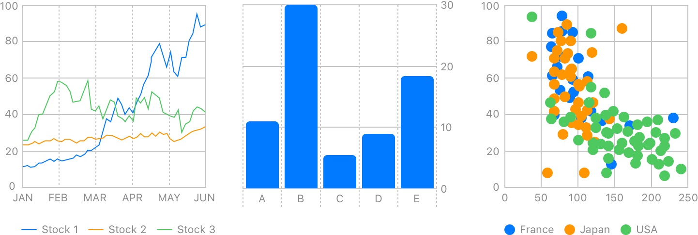

# Awesome Swift Charts

**From first bar to 3D plot.**

Hand-picked talks, articles, books and sample code for [Swift Charts](https://developer.apple.com/documentation/charts), Apple’s charting framework.

**[Browse the website →](https://artemnovichkov.github.io/awesome-swift-charts/)**

## Contents

- [Books](#books) (1)
- [WWDC Sessions](#wwdc-sessions) (7)
- [Articles](#articles) (28)
  - [Apple](#apple)
  - [Nil Coalescing](#nil-coalescing)
  - [Swift with Majid](#swift-with-majid)
  - [Artem Novichkov](#artem-novichkov)
  - [Create with Swift](#create-with-swift)
- [Videos](#videos) (5)
- [Examples](#examples) (5)
- [Tools](#tools) (1)

## Books

In-depth guides for going beyond the basics.

- [Swift Charts Beyond the Basics](https://books.nilcoalescing.com/swift-charts-beyond-the-basics) — Natalia Panferova & Matthaus Woolard. Data preparation, custom marks, scales, layering, styling, accessibility, selection, scrolling and animations.

## WWDC Sessions

Talks from Apple engineers and designers, newest first.

- **WWDC25** · [Bring Swift Charts to the third dimension](https://developer.apple.com/videos/play/wwdc2025/313)
- **WWDC24** · [Swift Charts: Vectorized and function plots](https://developer.apple.com/videos/play/wwdc2024/10155/)
- **WWDC23** · [Explore pie charts and interactivity in Swift Charts](https://developer.apple.com/videos/play/wwdc2023/10037/)
- **WWDC22** · [Hello Swift Charts](https://developer.apple.com/videos/play/wwdc2022/10136/)
- **WWDC22** · [Design an effective chart](https://developer.apple.com/videos/play/wwdc2022/110340/)
- **WWDC22** · [Swift Charts: Raise the bar](https://developer.apple.com/videos/play/wwdc2022/10137/)
- **WWDC22** · [Design app experiences with charts](https://developer.apple.com/videos/play/wwdc2022/110342/)

## Articles

Tutorials and deep dives from the community.

### Apple

- [Human Interface Guidelines: Charts](https://developer.apple.com/design/human-interface-guidelines/charts)

### Nil Coalescing

- [Visualising data with a hexagonal heatmap in Swift Charts](https://nilcoalescing.com/blog/VisualisingDataWithAHexagonalHeatmapInSwiftCharts/)
- [Building an accessible calendar chart with Swift Charts](https://nilcoalescing.com/blog/BuildingAnAccessibleCalendarInSwiftCharts/)
- [Build and style a chart with the new Swift Charts framework](https://nilcoalescing.com/blog/BuildAndStyleAChartWithSwiftChartsFramework)
- [Ridgeline plot with Swift Charts](https://nilcoalescing.com/blog/RidgePlotWithSwiftCharts)
- [Use SwiftUI views as points in scatter plot](https://nilcoalescing.com/blog/ScatterPlotWithCustomViews)
- [Plotting data distributions with Swift Charts](https://nilcoalescing.com/blog/PlottingDataDistributionsWithSwiftCharts)
- [Using Measurements from Foundation for values in Swift Charts](https://nilcoalescing.com/blog/UsingMeasurementsFromFoundationAsValuesInSwiftCharts)
- [Fill bar marks with gradient in Swift Charts](https://nilcoalescing.com/blog/FillBarMarksWithGradient)
- [Area chart with a dimming layer up to the current point in time](https://nilcoalescing.com/blog/AreaChartWithADimmingLayer)
- [Show chart annotations on hover in Swift Charts](https://nilcoalescing.com/blog/ChartAnnotationsOnHover)

### Swift with Majid

- [Mastering charts in SwiftUI. Pie and Donut charts.](https://swiftwithmajid.com/2023/09/26/mastering-charts-in-swiftui-pie-and-donut-charts/)
- [Mastering charts in SwiftUI. Scrolling.](https://swiftwithmajid.com/2023/07/25/mastering-charts-in-swiftui-scrolling/)
- [Mastering charts in SwiftUI. Selection.](https://swiftwithmajid.com/2023/07/18/mastering-charts-in-swiftui-selection/)
- [Mastering charts in SwiftUI. Accessibility.](https://swiftwithmajid.com/2023/02/28/mastering-charts-in-swiftui-accessibility/)
- [Mastering charts in SwiftUI. Legends.](https://swiftwithmajid.com/2023/02/22/mastering-charts-in-swiftui-legends/)
- [Mastering charts in SwiftUI. Customizations.](https://swiftwithmajid.com/2023/02/15/mastering-charts-in-swiftui-customizations/)
- [Mastering charts in SwiftUI. Interactions.](https://swiftwithmajid.com/2023/02/06/mastering-charts-in-swiftui-interactions/)
- [Mastering charts in SwiftUI. Custom Marks.](https://swiftwithmajid.com/2023/01/26/mastering-charts-in-swiftui-custom-marks/)
- [Mastering charts in SwiftUI. Mark styling.](https://swiftwithmajid.com/2023/01/18/mastering-charts-in-swiftui-mark-styling/)
- [Mastering charts in SwiftUI. Basics.](https://swiftwithmajid.com/2023/01/10/mastering-charts-in-swiftui-basics/)

### Artem Novichkov

- [Cook up 3D charts with Swift Charts](https://artemnovichkov.com/blog/cook-up-3d-charts-with-swift-charts)
- [Drawing maps with Swift Charts](https://artemnovichkov.com/blog/drawing-maps-with-swift-charts)
- [Github contribution graph with Swift Charts](https://artemnovichkov.com/blog/github-contribution-graph-swift-charts)

### Create with Swift

- [Using Swift Charts on a SwiftUI app](https://www.createwithswift.com/using-swift-charts-on-a-swiftui-app/)
- [Customizing a Chart in Swift Charts](https://www.createwithswift.com/customizing-a-chart-in-swift-charts/)
- [Making charts accessible with Swift Charts](https://www.createwithswift.com/making-charts-accessible-with-swift-charts/)
- [Plotting math equations using Swift Charts](https://www.createwithswift.com/plotting-math-equation-using-swift-charts/)

## Videos

Walkthroughs and experiments worth watching.

- [Swift Charts - Beyond the basics](https://www.youtube.com/watch?v=r22o9ZupNVk)
- [How FAST is Swift Charts? Can it handle a sound visualizer? - SwiftUI - iOS 16](https://www.youtube.com/watch?v=8kX1CX-ujlA)
- [Animating Swift Charts - Xcode 15](https://www.youtube.com/watch?v=rMuZ_ODipqQ)
- [Build Swift Charts Stocks App Part 4 - Chart View - SwiftUI iOS 16 App](https://www.youtube.com/watch?v=uI3Q9qyIs-Y)
- [Apple Engineer Creates a Budget Widget LIVE (Swift Charts)](https://www.youtube.com/watch?v=xgVSmJH2l6o)

## Examples

Sample code and open source projects to learn from.

- [Visualizing your app’s data](https://developer.apple.com/documentation/charts/visualizing_your_app_s_data) — Apple sample code
- [Creating a data visualization dashboard with Swift Charts](https://developer.apple.com/documentation/Charts/creating-a-data-visualization-dashboard-with-swift-charts) — Apple sample code
- [Swift Charts Examples](https://github.com/jordibruin/Swift-Charts-Examples)
- [BookstoreStategist - SwiftCharts Demo Project](https://github.com/gahntpo/BookstoreStategist)
- [Reproducing some D3 Charts with Swift Charts](https://github.com/raheelahmad/Swift-D3-Charts)

## Tools

Assistants that help you write chart code.

- [Apple Swift Charts Complete Code Expert](https://chatgpt.com/g/g-8U1iB3EIq-apple-swift-charts-complete-code-expert) — Custom GPT

## Contributing

Know a great resource? Pull requests are welcome.

1. Add the link to [`src/contents/index.md`](src/contents/index.md) (the website) and to this README.
2. Fetch link previews: `make previews`.
3. Preview locally with [Toucan](https://github.com/toucansites/toucan): `make dev`, then `make serve`.
4. Build the website into `docs/` before committing: `make dist`.
